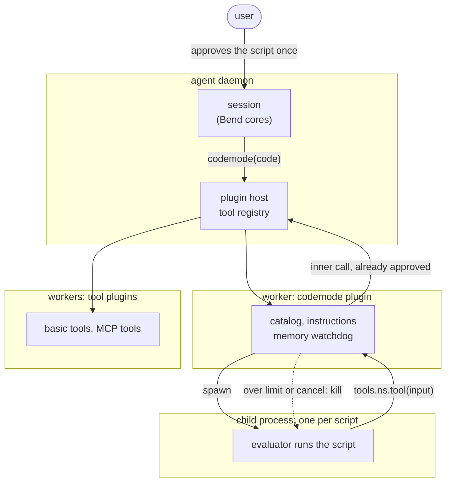

I am building a coding agent. It is a per-user daemon written in TypeScript, and every decision it makes — what to send to the model, when to ask the user, what a cancel closes — lives in a core written in [Bend](https://bend-lang.com), where laws are proved for every input. The agent is new and has no users yet, so I can try things that an established agent cannot.

One of those things is *codemode*. I started out to give the agent a JavaScript sandbox. I ended up with no sandbox at all: I kept the evaluator of [opencode's codemode package](https://github.com/anomalyco/opencode/tree/dev/packages/codemode), and I am replacing its scheduler with a Bend core. The design is not finished. But the path to it changed what I think the problem is, and that part is worth writing down now.

This post goes in the order I learned things: what codemode is, where it pays and where it does not, why the obvious engine was the wrong answer, what opencode got right, and why I split their package in two.

## What codemode is

An agent normally calls tools one at a time. The model asks for a tool, the agent runs it, the result goes into the transcript, and the model asks for the next tool.

In codemode the model writes a short program instead. The program calls the tools, and it can do in one step what took several requests: run independent calls at the same time, feed one result into the next call, filter a large result down to the three fields it needs, and return only that.

```js
const prs = await tools.github.list_pull_requests({ owner: "cli", repo: "cli", state: "closed", per_page: 20 })
const merged = prs.filter((p) => p.merged_at)
const files = await Promise.all(merged.map((p) => tools.github.get_pull_request_files({ owner: "cli", repo: "cli", pull_number: p.number })))
return merged.filter((p, i) => files[i].some((f) => f.filename.startsWith("pkg/cmd/"))).map((p) => ({ number: p.number, author: p.user.login }))
```

It promises to save three costs:

1. **Tool descriptions.** Every request carries the description of every tool offered. With many tools, that is tens of thousands of tokens on every request.
2. **Intermediate results.** A tool result goes into the transcript whole and is sent again with every later request, even when the model needed one field of it.
3. **Round trips.** A chain of dependent calls costs one request per step.

These are promises. I wanted measurements before I built anything.

## Experiment 1: codemode over the basic tools gives nothing

My agent has four basic tools: `bash`, `read`, `grep` and `write`. I gave a model (DeepSeek Flash, high reasoning effort) four tasks on a copy of the agent's own repository — count the laws per package, list exported functions, find mismatches between laws and proofs, count a code pattern per package. There were three conditions: the four plain tools; only a script tool with the four tools inside it; and both. 48 runs, all correct.

There was no consistent saving. On one task the script-only condition used 84k prompt tokens where plain tools used 47k.

The reason was in the logs. In the plain-tools condition, 83 of 111 `bash` calls used a pipe, a loop or inline Python. **A shell already is codemode for local work.** The model composes `rg | sort | uniq -c` as naturally as it composes JavaScript, and a script mostly wrapped one bash command. When both a script tool and plain tools were offered, the model chose the script in 3 of 16 runs.

So codemode is not a general improvement. The question became: where does a shell *not* reach?

## Where codemode pays: MCP and the tool explosion

A shell pipe filters text. An MCP tool returns a JSON object, and there is no pipe between two MCP tools. Worse, MCP tools come in large numbers. On my work machine an agent loads Slack, Atlassian and other servers — close to a hundred tools. The GitHub MCP server alone has 27 tools in its default read-only set, which is 8.3k prompt tokens of descriptions, and 91 tools with every toolset on.

The usual answer to this is *progressive disclosure*: do not send every description; give the model a search tool, and add a tool's schema only after the model finds it. My older agent does this. So the second experiment compared three conditions over the GitHub MCP server, on two tasks against the public `cli/cli` repository ("which of the 20 most recently merged pull requests changed a file under `pkg/cmd/`, with author and review count", and a similar one over issues and comments):

- **A**: every tool offered directly.
- **B**: progressive disclosure — a search tool plus an enable tool.
- **C**: codemode, with a 2,000-token catalog in the tool's description and a search call available inside the script.

All 18 runs were correct.

| | requests | uncached prompt | output | cost |
| --- | --- | --- | --- | --- |
| A, task 1 | 8.7 | 55.8k | 12.2k | $0.033 |
| B, task 1 | 10.3 | 75.8k | 14.6k | $0.042 |
| C, task 1 | 7.3 | 11.1k | 3.5k | $0.008 |
| A, task 2 | 6.0 | 55.7k | 7.1k | $0.026 |
| B, task 2 | 7.0 | 58.6k | 5.7k | $0.025 |
| C, task 2 | 7.7 | 10.8k | 5.0k | $0.010 |

Codemode cost about 30% of offering every tool and about 25% of progressive disclosure. Two things in that table surprised me.

**The saving comes from results, not from requests or descriptions.** All three conditions made about the same number of requests. Codemode's prompt was a fifth of the others' because the script filtered the GitHub JSON before anything entered the transcript. In one pilot run, a script made 54 GitHub calls; the model saw only the answer.

**Progressive disclosure alone did not save anything here.** It removes descriptions, but it does not remove results, and its search and enable steps add requests. It cost as much as offering every tool, or more. Its benefit grows with the number of tools; codemode's benefit comes on top of it.

That settles where codemode belongs: **MCP tools are reached only through codemode.** They never appear in the main tool list. The main loop sees five tools — the four basic ones and `codemode` — and the `codemode` tool's description carries a catalog: every MCP namespace with its tool count, plus as many full signatures as fit about 2,000 tokens. For the rest, the model writes a short discovery script that calls `tools.$codemode.search(...)` and returns the signatures it found, and then writes the real script. The main loop knows the table of contents without carrying the pages.

## Choosing an engine: QuickJS works, and that was not enough

To run model-written JavaScript, the obvious engine is QuickJS compiled to WebAssembly. It is a complete JavaScript engine in a separate heap, it is small, and it runs anywhere. I tried it first, in Bun, with the four basic tools injected as an async `tools` object.

It passed almost everything. Scripts called tools and returned values. `Promise.all` over four `sleep 1` calls took 1.09 s, so the host calls overlapped. `fetch`, `process`, `require`, `import()` and the usual constructor tricks reached nothing. A 16 MB memory limit stopped a runaway script, and deep recursion raised a stack overflow. A context cost 0.11 ms to create.

Two things did not fit.

- **A busy loop cannot be cancelled in-process.** While the script runs `while (true) {}`, the event loop is blocked, and only a deadline inside QuickJS stops it. A real hard cancel means putting QuickJS in a worker and terminating the worker.
- **The boundary is manual.** Every value that crosses into the WebAssembly heap is a handle that must be freed, and async calls need a hand-written bridge. During the experiment, disposing a context while a script still held an unresolved promise failed an assertion inside QuickJS, and the module was broken for every later script in the process. In a daemon where all sessions share one process, that is a serious failure mode, and it is the kind that tests do not find.

Then I read a tweet from one of the opencode developers:

> we specifically avoided using quickjs as our codemode implementation
>
> it brings in webasm complexity + forces worker threads + serialization of values back and forth

Two of those three I had just hit. The third, serialization, turned out not to matter: opencode copies values across its boundary too, and its per-call overhead (11.6 µs) was close to QuickJS's (8 µs).

## opencode's interpreter: rejected at first

opencode's codemode package parses the script with acorn and runs it in a tree-walking interpreter written with Effect. There is no global object, and the standard library is an allow-list. I ran the same checks against it.

| check | opencode | QuickJS |
| --- | --- | --- |
| `Promise.all` of four `sleep 1` | 1.09 s | 1.09 s |
| escape probes | none reachable | none reachable |
| host cancel during a busy loop | 400 ms | impossible in-process |
| memory | no limit: 4.6 GB in 3 s | 16 MB limit |
| sum of 10⁶ numbers | 1.5 s | 30 ms |

It also lacks part of the language: no classes, generators, `new Promise` or `.then`.

My first decision was QuickJS. opencode's interpreter had no memory limit, so one script could exhaust the process that holds every session. It was 50 times slower. And it could not run code a model might write. I wrote that decision into the design document with its reasons.

It was the wrong decision, and the reason was not in the table. I had compared two packages. I had not asked what problem the engine solves.

## The question I had skipped: what are we protecting against?

opencode's README has a section called *Authority Boundary*. Its central sentence is this:

> A program cannot gain authority through prose or generated code. It can only exercise authority already present in the supplied tools. Do not expose a broad tool and expect the prompt to restrict it.

QuickJS answers the question *how do I run arbitrary JavaScript safely?* It gives the guest the whole language and puts a wall around it. But codemode does not run arbitrary JavaScript. It runs a short program whose whole job is to call the tools it was given and move data between them. The risk is not that the program does something clever with the language. The risk is that it reaches something it was not given.

opencode's answer is to make the language itself the boundary. The interpreter implements only what an orchestration script needs. There is no `eval`, no module system, no host global, no prototype to mutate. The only door to the world is the `tools` object the host passes in. A script has no ambient authority, by construction — not because a wall stops it, but because there is nothing to climb.

Seen that way, each of my objections changes size:

- **Speed does not matter.** A codemode script spends its time waiting for tools. In the MCP experiment, the scripts did almost no computation. A 50× slower loop over a few hundred items is still milliseconds.
- **Missing features are a prompt problem.** The model is told the subset: `async`/`await` and `Promise.all` work, `class` and `.then` do not. When it forgets, the interpreter answers with an `UnsupportedSyntax` diagnostic that already names the correct form, and the model fixes its script.
- **Memory is a denial of service, not an escape.** A script that allocates without limit can take the process down. It cannot gain any authority. That needs containment, but it does not need a second language runtime.

It also changed a decision I had not expected it to touch: **approving a script approves every call it makes.** If the code is the whole of what can run, and it can only call the tools the session offers, the user can read the script once and decide. Asking again for each inner call would bring questions in bursts in the middle of a script (up to eight calls run at once), and a denial would leave the script half done.

The language is also not special. JavaScript is the choice because models write it well and because my agent is written in TypeScript. The principle — a small language whose only effect is calling granted tools — would work with any language.

## Containing what is left

Two risks remained, and I measured them in Bun rather than guessing.

**A catastrophic regular expression.** opencode runs regular expressions on the host engine, synchronously. I expected `/^(a+)+$/` on a long string to hang the thread. It did not. JavaScriptCore caps backtracking: the time grew exponentially up to 26 characters (235 ms) and then stayed at about 350 ms for any length up to 200. The catch is what happens at the cap: the engine reports *no match*, even when the correct answer is a match. `/^(?:(a+)+$|a+!)/` on 24 `a`s and a `!` is true; on 30 it is false. So a pathological pattern cannot hang the daemon, but it can quietly give a wrong answer, and the model should be told so.

**Memory.** My agent already runs every plugin in a Bun worker, so I hoped a worker would contain a runaway script. It does not. `worker.terminate()` stops a busy loop. But Bun ignored both `resourceLimits: { maxOldGenerationSizeMb: 256 }` and `smol: true`, the worker reached 3 GB either way, and after it exited the process still held 3.5 GB.

A child process does contain it. The child reports its resident memory to the parent every 20 ms over IPC, and the parent sends `SIGKILL` above a limit. With a 512 MB limit, the child was killed at 562 MB after 92 ms, and the parent stayed at 12 MB.

So each script runs in its own child process, killed above 512 MB or after five minutes. Five minutes, not two, because a script composes calls whose total length nothing predicts; a script that needs longer asks for it explicitly. Every inner call goes back through the daemon, so the session's tool set, hooks and logs apply to it.



## Why I am splitting opencode's package in two

At this point the plan was to use opencode's package as it is. Then I read its scheduler.

opencode's codemode is written to be used inside opencode, and it shows. The concurrency limit is a constant of 8. The per-call hooks can observe a call but cannot refuse, replace or delay it. The TypeScript compiler is a run-time dependency, used to strip types from the script. There is no way to drive the interpreter from outside; it runs a whole script as one Effect. None of this is a flaw for opencode. It is a problem for anyone who wants to put the idea inside a different agent.

Reading the code, I saw that the package holds two different kinds of code.

**The evaluator** turns syntax into values: scopes, closures, destructuring, operators, the standard library, the plain-data copies at the boundary, the blocked prototype members. It is most of the 3,500 lines of the interpreter, and it comes with parity tests against real JavaScript. This is the hard, careful, valuable part. It is language semantics, and it holds no decision worth a law.

**The scheduler** decides things about tool calls: when a call starts and when it queues; what `await`, `Promise.all`, `Promise.allSettled` and `Promise.race` deliver, and in what order; which calls a timeout or an abort interrupts; what the end of the program waits for; when an un-awaited failure is reported. It is a few hundred lines, spread across Effect fibers, a semaphore and fiber supervision.

The scheduler is exactly the kind of code my agent puts in Bend. It is a state machine: `step(state, event) -> (state', commands)`, with events such as *called*, *done*, *await*, *all*, *race*, *timeout*, *abort*, *end*, and commands such as *start*, *interrupt*, *resume*, *reject*. In opencode, some of its behaviour is not stated anywhere. When one member of `Promise.all` fails, the failure surfaces only after the members before it have settled, because the join goes in index order — no test pins this down. Whether a ninth queued call is counted against the call limit before or after it waits depends on the Effect version's semaphore. In a Bend core these become laws, proved for every input:

- at most N calls run at once;
- every call settles exactly once;
- a race has one winner, and every loser is interrupted;
- `Promise.all` delivers results in call order;
- nothing is delivered after an abort;
- every failed un-awaited call is reported.

There is a second reason, and it is the bigger one. The bugs I worry about are not inside opencode's scheduler, which is tested. They are at the seam between it and my daemon: a child process is killed while inner calls are still running in the daemon; a result arrives after the script is gone; a cancel reaches one layer before the other. Today those guarantees would rest on two layers happening to agree. With the scheduler in Bend, the script's calls and the daemon's inner calls can meet in one core, and a law can cover the whole chain: *after the script ends, by any route, every inner call is closed and no result reaches anyone.*

So the decision is: **a new package, forked from opencode's codemode.** It keeps the evaluator, the catalog and search, the schema checks around each tool call, and the sanitising of host errors. It replaces the scheduler with a Bend core, and drops what only opencode needs. opencode is MIT-licensed; the package keeps its copyright notice and license text and names the commit it came from.

One consequence follows from the authority argument, and I want it stated plainly. **The evaluator is now the security boundary.** With QuickJS, a mistake in the guest stays inside a separate heap. Here, every implemented feature has to be right: the blocked prototype members, the copies in and out, every standard-library method that runs on the host engine and must not hand back a host object. That is the price of dropping the wall. It also points the fork in a clear direction: each language feature removed is one less thing that has to be right.

## What is still open

The design is not finished.

- **Where the scheduler core runs.** In the child process beside the evaluator, each step is local, and the daemon keeps a separate ledger of inner calls. In the daemon, there is one core with laws over the whole chain, but every `await` crosses a process boundary.
- **The laws themselves.** The list above is a set of candidates, not approved laws.
- **An MCP client.** The daemon has none yet, and codemode's value depends on one.

What I have now is not code. It is a clearer statement of the problem. I started out asking which sandbox to use. The better question was what a script must not be able to do — and once that was answered, the sandbox turned out to be the part I did not need.

Thanks to the opencode team for the codemode package, and for the tweet that made me look again.
