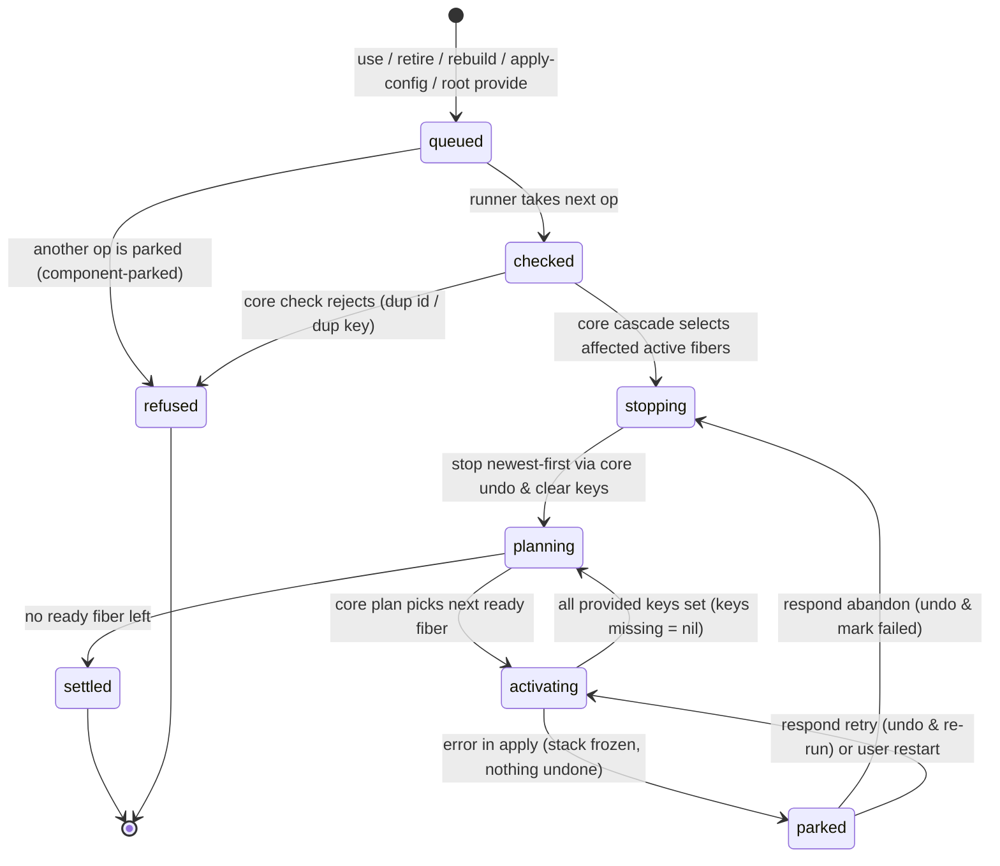
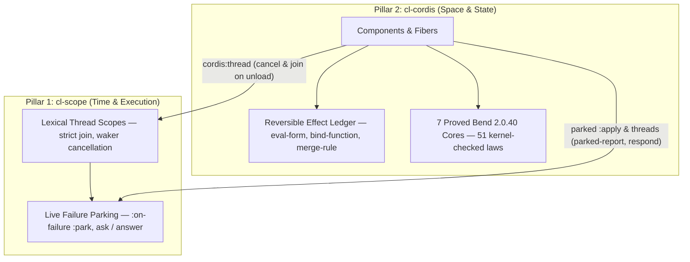

In [Part 1](/posts/2026-11-24-cl-scope-vs-effect-ts-fibers/), [`cl-scope`](https://github.com/nohzafk/cl-scope) gave my SBCL agent harness its first pillar: structured concurrency on native OS threads, cooperative cancellation, and live failure parking. I pointed out at the end that `cl-scope` deliberately leaves out the other half of Effect-TS — dependency graphs (`Layer`) and reverse-order resource finalizers (`Scope`).

In a live Common Lisp image, that missing half is an older and deeper problem. Lisp solved *runtime self-modification* decades ago: you can `eval` a new `defun`, redefine a macro, or hot-patch a running loop without restarting the process. Yet as I wrote [earlier](/posts/2026-08-18-lisp-could-always-mutate-itself/), classic Lisp never solved **clean undo**. Emacs's `unload-feature` tries its best by scanning `load-history` and removing functions from variables whose names end in `-hook`, then admits in its own documentation that package authors have to write manual unloaders when that fails. A human can always restart Emacs. A self-modifying agent cannot safely reboot the process that is supposed to repair it.

[Cordis](https://github.com/cordiverse/cordis) — the TypeScript meta-framework formalized in [*A Programming Paradigm for Spatiotemporal Composability*](https://arxiv.org/abs/2608.25512) (Yifan Shi, Wei Zhang, and Tianyi Cui; Peking University & DeepSeek-AI, 2026) and used in Koishi and DeepSeek Harness — turns dynamic composition into a system property rather than developer discipline.

I just extracted and open-sourced Pillar 2 of my harness: **[`cl-cordis`](https://github.com/nohzafk/cl-cordis)** (MIT licensed, 1,435 lines of SBCL Common Lisp, depending only on [`cl-scope`](https://github.com/nohzafk/cl-scope) and `sb-md5`). Its scheduling, cascading reload, hook chains, and reverse-undo decisions are computed by **7 formally proved Bend 2 (`2.0.40`) cores** — 51 kernel-checked laws, pre-emitted to Common Lisp so Lisp users need neither Bend nor Bun to load it.

## 1. Spatiotemporal composability: dependencies × reversible ledgers

In `cl-cordis`, a **component** declares the keys it reads (`:inject`), the keys it must set (`:provide`), any hooks it wraps (`:wrap`), and an `:apply` function. Loading a component creates a **fiber** — a live instance owning a **ledger** of reversible effects.

Every mutation a fiber makes to the image goes through `(cordis:effect callback)` (or the convenience macro `cordis:revertible`), which runs the setup and records its inverse function in the fiber's ledger. When the fiber stops — because you retired it, reloaded it, or a key it depended on changed — its ledger unwinds newest-first, and its provided keys are cleared.

Here is the core loop in action:

```lisp
(cordis:start)

(defparameter *log* '())

(defparameter *db*
  (cordis:make-component
   :name "db" :provide '(:db)
   :apply (lambda (config)
            (let ((url (getf config :url)))
              (push (list :open url) *log*)
              (cordis:revertible nil (push (list :close url) *log*))
              (cordis:provide :db url)))))

(defparameter *app*
  (cordis:make-component
   :name "app" :inject '(:db)
   :apply (lambda (config)
            (declare (ignore config))
            (let ((url (cordis:inject :db)))
              (cordis:eval-form `(defun banner () ,(format nil "app on ~a" url)))))))

(cordis:use *app*)                                      ; loaded, :blocked (missing :db)
(let ((db (cordis:use *db* :config '(:url "pg://1"))))  ; db activates, then app
  (let ((before (banner)))
    (cordis:retire db)                                  ; app stops first (BANNER gone), then db closes
    (list before (fboundp 'banner) (reverse *log*))))
;; => ("app on pg://1" NIL ((:OPEN "pg://1") (:CLOSE "pg://1")))

(cordis:stop)
```

Notice two properties right away:

- **Load order does not matter.** `*app*` loads before `*db*`, sits `:blocked` waiting on `:db`, activates automatically the moment `*db*` provides `:db`, and stops *before* `*db*`'s inverse runs when `*db*` is retired (so `*app*`'s own cleanup can still read `:db` while tearing down).
- **Every operation is serialized and followed by one reconcile pass.** `use`, `retire`, `rebuild`, `revive`, `apply-config`, and root `provide` run one at a time, asking the proved cores what to stop and what to start next:



## 2. Fifty-one proved Bend laws behind the runtime

Most plugin frameworks implement dependency resolution, cascade restarts, undo order, and hook chains by hand inside imperative callbacks. Subtle bugs hide there: a child component whose ledger runs *after* its parent's resources are already closed, a cascade that misses a transitive reader and leaves it running on stale data, or a hook reload that shifts a wrapper's position in the chain.

In `cl-cordis`, `cordis.lisp` never makes any of those discrete decisions by hand. Every one of them is delegated to **7 self-contained Bend `2.0.40` cores** (`bend/`, pre-emitted into `cores/`), whose laws are checked by Bend's kernel (`ALL PROOFS CHECK` across all 6 `PROOF.bend` files):

| Core | Proved laws | What it decides |
|---|---:|---|
| `keys` | 2 | Key-set membership and `missing` (provided keys left unset, undeclared reads/hooks) |
| `comp` | *(shared)* | Component record representation imported by `check`, `cascade`, and `plan` |
| `check` | 2 | Whether a load is refused (duplicate fiber id or duplicate key provider) |
| `cascade` | 3 | Exactly which active fibers must stop when keys change |
| `plan` | 3 | Sound, maximal, conserving activation schedule + blocked set |
| `undo` | 4 | Exact, newest-first inverse order including nested child ledgers |
| `hooks` | 37 | Wrapper uniqueness, in-place reload (`rejoin`), snapshot stepping, and stale-`inner` tokens |

These are not unit tests on a few inputs; they are universally quantified theorems in `bend/*/LAWS.bend`. For example, here are two laws from `bend/undo/LAWS.bend`:

```text
# Each installed effect's inverse runs exactly as often as it was installed, for every id.
law undo_exact:
  for +xs: List<&2, C.Entry>
  for +n: Nat
  {KF.count(n, C.undo(xs)) == KF.count(n, installed(xs)) : Nat}

# A child component's own ledger is released first, and its creation is reverted
# immediately after that and before the older remainder.
law undo_child:
  for +i: Nat
  for +ks: List<&2, C.Entry>
  for +t: List<&2, C.Entry>
  {C.undo(C.Sub{i, ks} <> t) == List.append(&2, Nat, C.undo(ks), i <> C.undo(t)) : List<&2, Nat>}
```

And `cascade_complete` from `bend/cascade/LAWS.bend`:

```text
# If the active order is valid from root and the registry is well-formed,
# no component left running injects a changed key or a key a restart provides.
law cascade_complete:
  for +root: List<&2, Nat>
  for +o: List<&2, M.Comp>
  for +d: List<&2, Nat>
  for hv: {MF.valid_order(o, root) == True{} : Bool}
  for hw: {MF.wf(root, o) == True{} : Bool}
  {none_hit(skip(o, M.ids(C.cascade(o, d))), MF.after(C.cascade(o, d), d)) == True{} : Bool}
```

## 3. Layered live-image definitions: making `defun` reversible in any order

In ordinary Common Lisp, if plugin A runs `(defun greet () :from-a)` and plugin B later runs `(defun greet () :from-b)`, unloading A has no clean answer if you only saved the previous `fdefinition`: blindly restoring what existed before A would clobber B, while leaving `greet` alone breaks when B unloads later.

`cl-cordis` models every `defun`, `defmacro`, `defvar`, `defparameter` (via `cordis:eval-form`), and `cordis:bind-function` as a **layer stack** per `(kind name)` place:

- The bottom of the stack captures whatever the image held before the first fiber touched that name (including "unbound").
- Each fiber pushes a layer; the newest layer is what the symbol currently resolves to.
- Removing a layer from *anywhere* in the stack deletes just that layer; only if the top layer was removed does `cl-cordis` restore the next layer down (or the original pre-Cordis binding if no layers remain).

```lisp
(cordis:start)
(defun greet () :original)

(let* ((a (cordis:use (cordis:make-component
                       :name "a"
                       :apply (lambda (c) (declare (ignore c))
                                (cordis:eval-form '(defun greet () :from-a))))))
       (b (cordis:use (cordis:make-component
                       :name "b"
                       :apply (lambda (c) (declare (ignore c))
                                (cordis:eval-form '(defun greet () :from-b)))))))
  (let ((both (greet)))
    (cordis:retire a)               ; non-LIFO: remove the older layer first
    (let ((only-b (greet)))
      (cordis:retire b)             ; now restore the original image definition
      (prog1 (list both only-b (greet))
        (cordis:stop)))))
;; => (:FROM-B :FROM-B :ORIGINAL)
```

For declarative reloads (`cordis:apply-config`), `cl-cordis` fingerprints each component file with `sb-md5` and rebuilds only entries whose file, config, disabled flag, or intercept changed. And to guard the boundary of the effect model, `(cordis:image :packages ...)` and `(cordis:image-diff a b)` compare function and variable bindings across packages — naming any raw `setf` or `defun` that escaped `cordis:effect`.

## 4. Interception metadata and snapshot-isolated hook chains

Two mechanisms handle cross-cutting policies without triggering full component cascades:

### Interception metadata (Cordis paper §3.2.3)

A key can carry **metadata** alongside its value. A reading component declares `:metadata`, every ancestor fiber adds its `:intercept`, and a thread can temporarily narrow metadata via `(cordis:with-intercept (key value ...) body...)`. Reading `(cordis:metadata key)` folds all layers outermost-first using an associative merge rule registered via `(cordis:merge-rule key merge &optional empty)` (which is itself a reversible effect).

In my agent harness, `:tools` uses this for tool policies (`:deny` and `:ask` lists merged down the fiber tree and dynamic scope). Changing metadata via `with-intercept` touches no global state, leaks to no other thread, and reloads nothing.

### Hook chains (`define-hook`, `:wrap`, `chain`)

The root declares a hook with its default function; components wrap hooks via `:wrap ((hook . wrapper) ...)`, where each wrapper receives `(inner input)`:

```lisp
(cordis:start)
(cordis:define-hook "format.reply" (lambda (x) (format nil "raw:~a" x)))

(cordis:use (cordis:make-component
             :name "outer"
             :wrap (list (cons "format.reply"
                               (lambda (inner x)
                                 (format nil "[~a]" (funcall inner x)))))))
(cordis:use (cordis:make-component
             :name "inner"
             :wrap (list (cons "format.reply"
                               (lambda (inner x)
                                 (funcall inner (string-upcase x)))))))

(prog1 (cordis:chain "format.reply" "ok")
  (cordis:stop))
;; => "[raw:OK]"
```

The 37-law `hooks` core guarantees three tricky invariants:

1. **Slot stability across reloads.** When `apply-config` replaces a fiber with a new version, its wrappers keep their original slot in the chain instead of jumping to the end; inactive fibers are skipped without losing their slot.
2. **Call-level snapshot isolation.** A `chain` call runs against the chain snapshot captured when the call began — a wrapper loaded mid-call takes effect from the next call onward.
3. **No stale `inner` calls.** Every `inner` closure wraps a token issued by the `hooks` core: invoking `inner` after its call returns signals `stale-inner` (`:ended`), and invoking an `inner` stashed from an earlier activation of its fiber signals `stale-inner` (`:stale`).

## 5. Where the two pillars meet

`cl-scope` and `cl-cordis` stay cleanly orthogonal — `cl-scope` knows nothing about components or ledgers — and meet at exactly two bridges:



1. **`cordis:thread` turns a `cl-scope` scope into a reversible effect.** A component starts background work with `(cordis:thread fn :name ...)`. Its inverse in the fiber's ledger cancels that scope (`sc:cancel-scope`) and joins the supervisor thread before the component finishes unloading. No background thread can outlive the component that started it.
2. **A failing `:apply` parks instead of blindly rolling back.** In TypeScript Cordis, an exception during component activation immediately unwinds and rolls back. In `cl-cordis`, the serialized operation runner executes inside a `cl-scope` `:on-failure :park` scope. When `:apply` signals an error, it freezes on its live SBCL call stack with nothing undone yet:
   - Any other lifecycle operation arriving while the runner is parked (including ones already queued behind it) is immediately refused with `component-parked`, preventing deadlocks if a supervisor or repair turn tries to modify components while answering the park.
   - `(cordis:respond id 'cordis:abandon)` unwinds the partial ledger via `undo` and marks the fiber failed (matching TypeScript Cordis's rollback).
   - `(cordis:respond id 'cordis:retry)` unwinds the partial ledger and re-runs `:apply` — picking up any function you just hot-redefined in the live image.
   - Answering with a restart established inside `:apply` itself resumes from the exact failing form without redoing earlier setup.

## 6. Verification and honest limits

`cl-cordis` is verified at three layers:

- **Formal proofs (`bend/`):** 51 laws across 6 `PROOF.bend` files, all `ALL PROOFS CHECK` under Bend `2.0.40`.
- **Automated checks (`./check.sh`):** 51 checks in one image — including `Z1` (700 drawn conformance cases for `check`/`plan`/`cascade`/`undo`), `Z2` (250 hook-chain operation sequences / 6,214 operations), and zero-thread-leak enforcement — plus `K1`, which boots a second fresh SBCL image on the final configuration and verifies that the live image after a long history of loads, edits, reloads, and removals matches a clean boot identically (**52 checks total**).
- **Mutation suite (`./mutants.sh`):** **72 mutants** disabling one invariant of `cordis.lisp` at a time, running in parallel in ~10 seconds — **72/72 caught**.

And the honest limits:

- **SBCL only** (depends on `cl-scope` and `sb-md5`).
- **`cordis:effect` is the boundary.** A raw `setf` of a global, a CLOS method, a class, or a package created outside `cordis:effect` will remain after unload (`image-diff` flags unexpected function/variable changes after the fact; it does not sandbox them).
- **Parked operations serialize the runtime.** While an `:apply` is parked (or blocks forever), no other component loads or unloads until it is answered.
- **Inlined callers keep the old function.** Active calls finish on the function object they entered, and callers compiled with an old function inlined keep the inlined body.
- **One variable layer per fiber.** Setting the same variable twice inside one fiber updates that fiber's single layer rather than stacking two undo steps.

---

With [`cl-scope`](https://github.com/nohzafk/cl-scope) governing *time* and [`cl-cordis`](https://github.com/nohzafk/cl-cordis) governing *space and state*, both foundations of the live-image agent harness are now open source and independent of the harness itself.

Next in this series, Part 3: putting both pillars together inside a running agent — what happens when the harness hits a bug in its own code mid-turn, parks the turn on its live stack, spawns a repair turn, patches itself safely under reversible effects, and resumes without repeating a single tool call.
