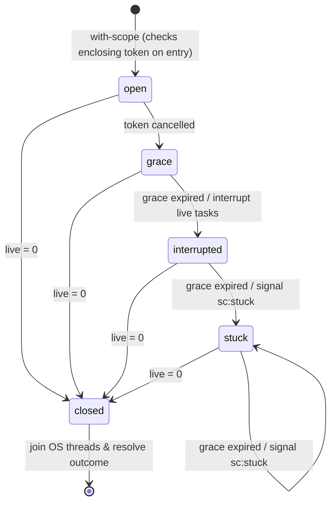
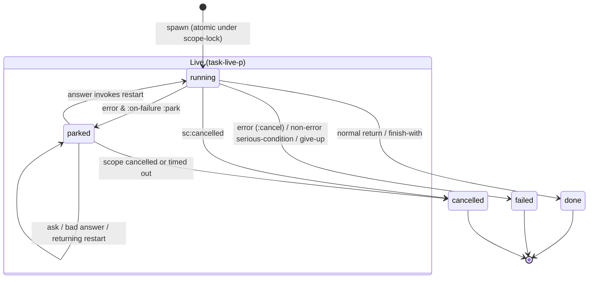

I am building an agent harness with Common Lisp (SBCL) as its foundation — a long-lived live image where the harness loop, its tools, and its Bend-proved cores share a single process, heap, and debugger.

Two orthogonal pillars hold that harness up:

1. **Structured concurrency ([`cl-scope`](https://github.com/nohzafk/cl-scope))** — the *time* axis: bounded task lifetimes, cooperative cancellation, timeouts, and live failure recovery across native OS threads.
2. **A Cordis meta-framework for spatiotemporal composability (`cl-cordis`)** — the *space and state* axis: component dependency graphs, live-image layering, and reversible side-effect ledgers so a self-modifying Lisp image can actually [undo what it changed](/posts/2026-08-18-lisp-could-always-mutate-itself/).

This is the first post in the *A Live-Image Agent Harness* series. I just open-sourced [`cl-scope`](https://github.com/nohzafk/cl-scope) (536 lines of SBCL Common Lisp, zero external dependencies, MIT licensed). Rather than walking through an API listing, the clearest way to explain its design choices is to compare it directly with the most thoroughly engineered structured-concurrency runtime in the TypeScript ecosystem: **Effect-TS and its `Fiber`**.

## Same problem, opposite host runtimes

Effect-TS `Fiber` and `cl-scope` exist to solve the exact same set of concurrency problems: no leaked background work, hierarchical cancellation, clear failure propagation, and scoped context inheritance. They look very different because they stand on opposite runtimes.

| Dimension | Effect-TS (`Fiber` + `Scope`) | `cl-scope` (`scope` + `task`) |
|---|---|---|
| **Execution carrier** | User-space green threads (trampoline state machine) on JS's single-threaded event loop | Native SBCL OS threads (`sb-thread`) with real machine call stacks |
| **Programming style** | Pure functional effect monad (`Effect<A, E, R>` via `Effect.gen` / `pipe`) | Direct-style Common Lisp — no monads, no function coloring |
| **Structured boundary** | Parent-child fiber supervision tree + `Effect.scoped` | Lexical `sc:with-scope` (strictly joins every child OS thread before exit) |
| **Failure model** | Unwind stack + typed error algebra (`Cause<E>`), then catch or retry | `:on-failure :cancel` or `:on-failure :park` — freeze on the live stack via `handler-bind`, inspect, hot-fix, and resume in place |
| **Cancellation / interruption** | Checked between virtual steps + `Effect.uninterruptible` | Waker-backed waits (`pause`, `recv`, `wait-on`, `run`, sockets) + `sc:shielded` + grace-period `interrupt-thread` fallback |
| **Context propagation** | `FiberRef<A>` (copied on fiber fork) | `sc:*inherit*` (explicit allowlist of dynamic special variables rebound at `spawn`) |
| **Dependencies & teardown** | Bundled into `Layer` + `Scope` finalizers | Orthogonally separated into `cl-cordis` (Part 2) |

## 1. Execution model: trampoline fibers vs native OS threads

JavaScript gives Effect-TS a single-threaded event loop and native Promises that can neither be cancelled nor pause a call stack. To get structured concurrency anyway, Effect-TS builds a cooperative trampoline interpreter in user space. Every `Fiber` is a lightweight heap-allocated frame queue.

That buys you very cheap concurrency — tens of thousands of fibers in one process — at two structural costs:

- **Total function coloring.** Anything that participates in cancellation, context, or typed errors has to live inside `Effect<A, E, R>` (`Effect.gen`, `yield*`, combinators).
- **Single-core execution.** CPU-bound work still shares the single JS thread unless marshaled across workers.

`cl-scope` takes the opposite route: it builds directly on SBCL's native OS threads. A task is an ordinary zero-argument Lisp function running on a real thread (`sc:task-thread` returns the `sb-thread:thread` directly). Ordinary Lisp functions run unmodified, with zero coloring and real multi-core parallelism. In my harness, `parallel` and `pmap` are two-line wrappers around `sc:gather`:

```lisp
(sc:gather (list (lambda () (sc:run "/bin/sh" '("-c" "echo one")))
                 (lambda () (sc:run "/bin/sh" '("-c" "echo two"))))
           :timeout 10)
;; => ("one\n" "two\n")
```

OS threads are heavier than heap-allocated fibers, of course, though not nearly as heavy as people assume at harness scale. In `cl-scope`'s own check suite on macOS arm64, spawning and joining **200 concurrent tasks** that each wait 100 ms completes in **~115 ms** total; cancelling 200 blocked tasks at a 100 ms timeout finishes in **~120 ms**, with zero leaked threads afterwards.

## 2. Cancellation without blind interruption — and explicit state machines

Because Effect-TS evaluates every `flatMap` through its own loop, it can interrupt a fiber cleanly between any two pure effect steps, guard critical sections with `Effect.uninterruptible`, and wait for finalizers before the interrupt call returns (back-pressured interruption). Its blind spot is synchronous JavaScript: a plain `while (true) {}` loop starves the event loop, and the Effect scheduler never gets another tick to interrupt it.

On native OS threads, you have the mirror-image constraint. You *can* interrupt a busy-looping thread from the outside, but blindly firing `sb-thread:interrupt-thread` at an arbitrary instruction can land inside a mutex acquisition or half-finished cleanup.

`cl-scope` resolves this in three layers — **cooperative first, preemptive only as a last resort**:

1. **Wakers at every blocking site.** Every scope owns a hierarchical cancellation token. Built-in waits (`sc:pause`, `sc:recv`, `sc:wait-on`, `sc:run`, `sc:read-line-from`) and custom blocking calls (`sc:call-with-waker`) register a waker on that token. When a scope is cancelled (via `sc:cancel-scope`, `:timeout`, a body error, or a sibling failure), every waker fires immediately — broadcasting condition variables, shutting down sockets (`:direction :io`), or sending `SIGTERM` to a subprocess's entire process group (`killpg`), followed by `SIGKILL` on unwind — and cascades to child tokens. Errors raised by individual custom wakers are isolated so one broken waker cannot stall sibling wakers or child scopes.
   Measured wake latency on my machine: **~4 ms** for `pause` / `recv`, **~7 ms** for a shell spawning a sleeping grandchild process (verifying the grandchild is gone too), and **~14 ms** for a blocked TCP socket read.
2. **`sc:cancelled` is a `condition`, not an `error` (or `serious-condition`).** In Common Lisp, that hierarchy choice does real work: task code wrapped in `(ignore-errors ...)` or `(handler-case ... (error ...))` will never accidentally swallow a cancellation. Waits inside `unwind-protect` cleanups are cancelled too unless explicitly wrapped in `(sc:shielded ...)` — `cl-scope`'s direct equivalent of `Effect.uninterruptible`.
3. **Grace-period escalation via an explicit state machine.** If a cancelled task sits in a tight CPU loop, calls plain `cl:sleep`, or gets wedged inside an `*on-park*` callback, `join` walks an explicit shutdown state machine rather than spinning or leaking the thread:



After one `:grace` period (default 1 s), `cl-scope` falls back to `sb-thread:interrupt-thread` on every task still in a live state (`:running` or `:parked`). If the thread ignores even that (for example, inside `sb-sys:without-interrupts`), the scope refuses to return with an orphan thread alive: it transitions to `:stuck` and signals `sc:stuck` once per grace period until the task exits.

Making both shutdown *and* exit resolution explicit state machines paid off immediately before open-sourcing. In the first version of `cl-scope`, `call-with-scope` tracked the body's exit with a three-valued flag (`nil`, `:own`, `t`) alongside scattered checks on `scope-failure` and `token-reason`. That implicit state machine missed a real transition: if an inner `sc:gather` had already finished spawning its tasks (body returned normally) and was waiting in `join` when an *outer* scope timed out, the inner `gather` saw its tasks cancelled and returned `(NIL NIL)` instead of propagating `sc:cancelled`.

Replacing that ad-hoc flag with an exhaustive 5-state `scope-outcome` (`:failed`, `:completed`, `:outer-cancelled`, `:timed-out`, `:cancelled`) eliminated the gap structurally:

| Priority | State after `join` closes the scope | Outcome | `with-scope` result |
|---|---|---|---|
| 1 | First task failure recorded (`scope-failure`) | `:failed` | Signals `sc:task-error` |
| 2 | Scope token not cancelled | `:completed` | Returns body's values |
| 3 | Cancelled by an ancestor scope (`origin ≠ self`) | `:outer-cancelled` | Signals `sc:cancelled` (even if cancelled during `join`) |
| 4 | Cancelled by this scope's `:timeout` | `:timed-out` | Signals `sc:timed-out` |
| 5 | Cancelled directly via `sc:cancel-scope` | `:cancelled` | Returns `nil` |

(If the body itself unwinds via an error, non-local exit, or outer cancellation, `unwind-protect` cancels child tasks with `:scope-exit`, joins them, and lets the body's unwind continue without reaching `scope-outcome`.)

Similarly, `sc:spawn` creates the OS thread and records `task-thread` *before* pushing the task and incrementing `scope-live` under `scope-lock`, so no half-born task (`state = :running`, `thread = nil`) is ever visible to `join` or leaked if thread creation fails.

## 3. Dynamic context: `FiberRef<A>` vs `sc:*inherit*`

JavaScript has no dynamic scope, and Node's `AsyncLocalStorage` sits outside Effect's scheduler. Effect therefore provides `FiberRef<A>`: whenever a parent forks a child fiber, the runtime shallow-copies the parent's `FiberRef` map into the child.

Common Lisp already has dynamic special variables built into the language. The only missing piece is that SBCL's `sb-thread:make-thread` starts a fresh thread with global values rather than the parent's current `let`-bindings. `cl-scope` bridges that in a few lines with `sc:*inherit*`:

```lisp
(defvar *request-id* nil)

(let ((*request-id* "req-42")
      (sc:*inherit* (adjoin '*request-id* sc:*inherit*)))
  (sc:gather (list (lambda () *request-id*)
                   (lambda () (first (sc:gather (list (lambda () *request-id*))))))))
;; => ("req-42" "req-42")
```

At `sc:spawn` time, `cl-scope` captures only the special variables listed in `sc:*inherit*` (plus `*inherit*` and `*on-park*` automatically so nested scopes keep propagating them) and rebinds them in the child thread via `progv`. Inside any task, reading context is just reading a normal Lisp variable — no `FiberRef.get`, no `yield*`, no explicit threading through function signatures.

## 4. The real divide: stack unwinding (`Cause<E>`) vs parking in place (`:on-failure :park`)

This is where the two designs stop being analogous and diverge fundamentally.

Effect-TS has one of the richest failure representations in mainstream programming. `Cause<E>` cleanly separates expected domain failures (`Fail(E)`), unexpected defects (`Die`), interruptions (`Interrupt`), and sequential or parallel composite failure trees. You can match on them with precision and build sophisticated retry or fallback policies.

Yet no matter how expressive `Cause<E>` is, **the call stack has already unwound** before any recovery code runs.

In a stateless HTTP handler, unwinding and retrying is usually fine. In an agent harness, it is brutal. Imagine an agent turn that has run five expensive tool calls, accumulated partial state across dynamic bindings, and hits a bug in a harness helper on step six. Once the stack unwinds, steps one through five are gone. You either throw away the turn or re-run side-effecting tool calls.

Common Lisp's condition system was designed around a different idea: **signalling a condition does not unwind the stack**. A `handler-bind` handler runs *in the dynamic context of the error* while every caller frame, local binding, and `restart-case` below it is still alive.

`cl-scope` lifts that mechanism across OS threads inside structured concurrency. Every task obeys a small, explicit lifecycle state machine:



When a scope is opened with `:on-failure :park`:

1. Any `error` signalled inside a task freezes that task **at the exact failing frame** (`:parked`), keeping its real SBCL call stack, local frames, and live dynamic bindings intact. (Non-`error` `serious-condition`s such as heap or stack exhaustion still unwind normally.)
2. Sibling tasks in the same scope keep running unaffected.
3. Another thread — a REPL, a supervisor, or in my harness a dedicated *repair turn* — receives the parked task via `sc:*on-park*` or `(sc:parked scope)`, inspects its error (`sc:task-condition`), trimmed backtrace (`sc:task-report`), and offered restarts (`sc:task-restarts`), **evaluates diagnostic code inside the parked thread's live dynamic context via `sc:ask`**, hot-redefines the broken function in the live image, and resumes the task in place via `sc:answer`.

Here is a complete, runnable example from `cl-scope`:

```lisp
(defvar *request-id* nil)

(defun compute (x)
  (error "buggy implementation for ~a" x))

(let ((parked-events (sc:make-chan)))
  (let ((sc:*on-park* (lambda (task) (sc:send parked-events task))))
    ;; Supervisor thread: inspect the parked task, fix the function, and retry it.
    (sb-thread:make-thread
     (lambda ()
       (let ((task (sc:recv parked-events)))
         (format t "Failed with: ~a~%" (sc:task-condition task))
         (format t "Stack: ~s~%" (sc:task-report task))
         (format t "Restarts: ~s~%" (sc:task-restarts task))
         ;; Evaluate code inside the parked task's thread & live dynamic bindings:
         (format t "Request ID: ~s~%" (sc:ask task (lambda () *request-id*)))

         ;; Hot-fix the broken function and resume the task in place:
         (defun compute (x) (* x 2))
         (sc:answer task 'sc:retry))))

    ;; Sibling tasks keep running while the failed one is parked.
    (sc:gather (list (lambda () (let ((*request-id* "req-42")) (compute 21)))
                     (lambda () (sc:pause 0.1) :ok))
               :on-failure :park)))
;; => (42 :OK)
```

Every task automatically offers three built-in restarts (`sc:retry`, `sc:give-up`, `sc:finish-with`) alongside any domain restarts established by user code (or pass `:restarts nil` to expose only user restarts). In a multi-step tool loop, a task can establish fine-grained restarts like `retry-step` or `use-value`: when step 6 parks, the supervisor fixes the bug and invokes `retry-step`, and steps 1 through 5 are never re-executed.

Two small details make parking safe in production rather than a REPL toy:

- **Bad answers stay parked.** Passing an unknown restart name, wrong arguments, or invoking a restart that returns without transferring control does not crash the task; it remains `:parked` and records the failure reason in `(sc:task-note task)`.
- **Cancellation always wins.** If the enclosing scope times out or is cancelled while a task is parked, `recv` inside `park` wakes immediately with `sc:cancelled` and unwinds the task cleanly.

In my harness, turn scopes run with `:on-failure :park`. When harness code hits a bug mid-turn, the failing task parks where it broke; a separate repair turn runs `sc:ask` to inspect the parked thread's live state, patches the function in the image, and calls `sc:answer` to continue the original turn from the exact frame where it stopped. That "fix and continue across threads" workflow is something no runtime built on stack-unwinding exceptions or short-circuiting monads can offer natively.

## 5. What `cl-scope` deliberately leaves out

In Effect-TS, `Fiber` is tightly integrated with two other abstractions: `Context` / `Layer` (dependency graph construction and teardown) and `Scope` finalizers (`acquireRelease` run in reverse order).

`cl-scope` intentionally leaves all of that out. Keeping concurrency control flow orthogonal is why the entire library fits in **536 lines** with zero dependencies, 32 automated checks, and 12 mutation tests (all 12 caught).

In my architecture, dependency graphs, live-image layering, and reversible side-effect ledgers belong to the second pillar: **`cl-cordis`**, a Common Lisp component meta-framework inspired by the Cordis paper, whose scheduling, cascading reload, hook chains, and reverse undo logic are proved in Bend 2 and compiled to SBCL. A single primitive (`cordis:thread`) bridges the two pillars: each component's background work runs in a `cl-scope` scope, and unloading the component cancels and joins that scope automatically.

## Honest trade-offs

`cl-scope` is opinionated about what it optimizes for and what it gives up:

- **SBCL only.** It relies directly on `sb-thread`, `sb-ext`, `sb-bsd-sockets`, and `sb-debug`.
- **One OS thread per task.** Parked tasks hold their OS thread alive until answered or cancelled. That is ideal for dozens or hundreds of agent turns, subprocesses, and concurrent tool calls; it is not meant for 100,000 idle network connections in one process.
- **Foreign blocking calls and raw mutexes.** Blocking CFFI calls need a custom waker via `sc:call-with-waker`, and a thread blocked on a raw mutex (instead of `sc:wait-on`) will only be stopped when the `:grace` interrupt fires.

---

If I had to compress the comparison into two sentences:

Effect-TS `Fiber` builds a remarkably complete virtual operating system in user space to compensate for what JavaScript lacks — preemptive multi-core threads, structured cancellation, dynamic scope, and typed failure tracking. `cl-scope` takes the opposite approach: it leans directly into what an SBCL live image already gives you — real OS threads, dynamic variables, and non-unwinding conditions and restarts — adding only the thinnest structured concurrency layer needed to keep them disciplined.

The code is on GitHub at [nohzafk/cl-scope](https://github.com/nohzafk/cl-scope). Next in this series, Pillar 2: **`cl-cordis`** — how a live Common Lisp image gets a proved dependency graph, reversible side-effect ledgers, and clean undo.
